# Embedded Equipment Health & Communication Monitor

[](https://opensource.org/licenses/MIT)
[](https://www.st.com/en/microcontrollers-microprocessors/stm32f446re.html)
[](https://www.espressif.com/en/products/socs/esp32)
[](https://flask.palletsprojects.com/)

A real-time embedded telemetry, health monitoring, and fault-injection testbed developed by the **Electronics & Robotics Club, BITS Pilani**.

The system establishes deterministic full-duplex communication between an **STM32 Equipment Master** and an **ESP32 Telemetry Gateway**, measuring sub-millisecond round-trip response times (RTT) via a hardware stopwatch and serving live metrics to an interactive web dashboard.

---

## Architecture Overview

```mermaid
flowchart LR
    subgraph STM32 [STM32F446RE Master Node]
        M_CORE[ARM Cortex-M4 @ 16 MHz]
        TIM2[TIM2 Microsecond Stopwatch]
        SPI_DMA[SPI1 Master + DMA2 S2/S3]
        BTN[Blue Button B1 / PC13 Fault]
    end

    subgraph ESP32 [ESP32 Gateway Node]
        CORE0[Core 0: SPI Slave Task]
        CORE1[Core 1: Watchdog & HTTP Ingest]
        WIFI[Wi-Fi 802.11 b/g/n]
    end

    subgraph DASHBOARD [Web Application]
        FLASK[Flask Backend Port 5000]
        SSE[Server-Sent Events Stream]
        UI[Live Chart.js UI Dashboard]
    end

    STM32 -- Full-Duplex SPI DMA (64-byte Flit + ACK) --> ESP32
    STM32 -- Dual UART (115200 baud) --> ESP32
    ESP32 -- HTTP POST JSON Telemetry --> DASHBOARD
    DASHBOARD -- Real-Time Updates --> UI
```



---

## Hardware Pinout & Wiring

| Signal | STM32 Nucleo-F446RE | ESP32 DevKit | Description |
| :--- | :--- | :--- | :--- |
| **SPI CS / NSS** | `PA4` (CN8 Pin 3) | `GPIO 5` | Chip Select (Active LOW) |
| **SPI SCK** | `PA5` (CN8 Pin 2) | `GPIO 18` | SPI Clock (~250 kHz Mode 0) |
| **SPI MISO** | `PA6` (CN8 Pin 1) | `GPIO 19` | Slave Out / Master In (ACK) |
| **SPI MOSI** | `PA7` (CN5 Pin 4) | `GPIO 23` | Master Out / Slave In (Flit) |
| **UART TX / RX** | `PA9` (Arduino D8) | `GPIO 16` (RX2) | Dual Telemetry Serial Stream |
| **UART VCP** | `PA2` (ST-LINK) | *USB to PC* | ST-LINK PC Serial Monitor |
| **GND** | `GND` | `GND` | **Mandatory Common Ground** |

---

## Key Features

1. **Deterministic 64-Byte Full-Duplex Flits:**
   * STM32 clocks out sequenced 64-byte payload packets using Direct Memory Access (DMA2 Stream 3).
   * ESP32 SPI Slave on Core 0 receives the payload and transmits the `ACK` heartbeat simultaneously in the same transaction.
   * Latency dropped from 374 ms down to **~2.0 ms**.

2. **Microsecond Hardware Stopwatch (`TIM2`):**
   * Configured as a 1 MHz free-running 32-bit counter (1 tick = 1 µs).
   * Stamps `t_REQUEST` on CS low and `t_ACK` upon DMA completion:
     $$\text{RTT} = t_{\text{ACK}} - t_{\text{REQUEST}}$$
   * The exact RTT latency is packed directly into bytes 4..7 of each SPI flit.

3. **Dual-Broadcast UART:**
   * Broadcasts telemetry on **both USART2 (PA2 / USB to PC)** and **USART1 (PA9 / Pin D8 to ESP32)** at 115200 baud.

4. **Hardware Fault Injection (PC13 Button):**
   * Pressing and holding the onboard **Blue Pushbutton (B1 / PC13)** halts SPI transfers.
   * ESP32's watchdog detects the heartbeat loss (> 2.5s) and triggers a **`FAULT ALERT`**.
   * Releasing the button restores transmission, triggering **`RECOVERED` $\rightarrow$ `NORMAL`** transitions.

5. **Real-Time Web Dashboard:**
   * Real-time RTT response time graph and inter-ACK cadence tracking.
   * Interactive simulated fault injection button.
   * Server-Sent Events (SSE) live updates with zero polling delay.

---

## Repository Structure

```text
├── ESP32_Dashboard/
│   └── ESP32_Dashboard.ino       # ESP32 Core 0 SPI slave, health monitor & Wi-Fi bridge
├── STM32_SPI/
│   ├── Inc/                       # Header files (spi.h, uart.h, gpio.h, stm32f4xx.h)
│   ├── Src/
│   │   ├── main.c                 # Primary control loop, stopwatch & fault logic
│   │   ├── spi.c                  # SPI1 master register & DMA2 stream configuration
│   │   ├── uart.c                 # Dual-channel UART transmission (USART1 + USART2)
│   │   └── gpio.c                 # GPIO alternate function initialization
│   ├── Drivers/                   # CMSIS and HAL device drivers
│   └── STM32F446RETX_FLASH.ld     # Linker script
├── Web_Dashboard/
│   ├── server.py                  # Flask ingestion API & Server-Sent Events backend
│   ├── requirements.txt           # Python dependencies
│   ├── templates/
│   │   └── index.html             # Responsive telemetry dashboard UI
│   └── static/
│       ├── css/dashboard.css      # Custom styling & dark/light theme
│       └── js/dashboard.js        # Chart.js live plots & state controller
├── .gitignore                     # Git ignore rules for build artifacts
└── README.md                      # Project documentation
```

---

## Quickstart

### 1. STM32 Master
1. Open [`STM32_SPI`](STM32_SPI/) in **STM32CubeIDE**.
2. Build and flash the project to your **NUCLEO-F446RE** via USB.
3. Open a terminal on the ST-LINK Virtual COM port at **115200 baud** to view real-time flit output:
   ```text
   FLIT: 120, ACK: 1, TIME_BETWEEN_ACKS: 500, LATENCY: 2058
   ```

### 2. ESP32 Gateway
1. Open [`ESP32_Dashboard/ESP32_Dashboard.ino`](ESP32_Dashboard/ESP32_Dashboard.ino) in **Arduino IDE**.
2. Update the Wi-Fi credentials (`ssid`, `password`) and target dashboard IP (`serverName`).
3. Select board **ESP32 Dev Module** and flash via USB.

### 3. Web Dashboard
1. Install dependencies:
   ```bash
   cd Web_Dashboard
   pip install -r requirements.txt
   ```
2. Start the server:
   ```bash
   python server.py
   ```
3. Open [`http://localhost:5000`](http://localhost:5000) in your browser.

---

## Authors & Credits
* **Electronics & Robotics Club**, BITS Pilani
* Open Day Demonstration & Embedded Hardware Diagnostics

